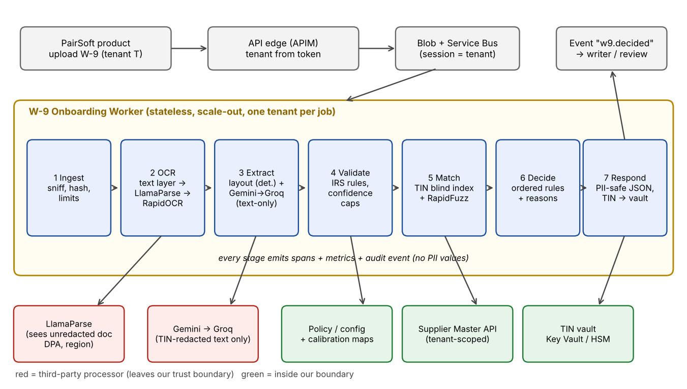
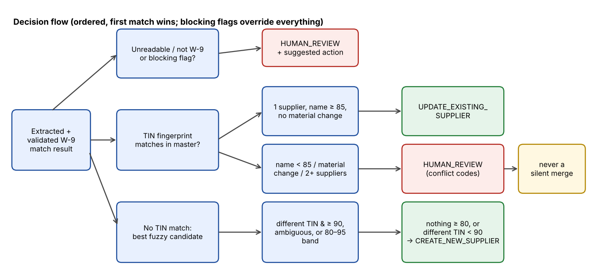

# W-9 Supplier Onboarding Service: Design Document

**Author:** Karl (KHM Technology) · **For:** PairSoft Central AI Services case study · **Version:** 1.1 (October 2026)

This is the short design (PDF: `docs/DESIGN.pdf`). The long version with every rule table, the full JSON example and the evaluation tables is `docs/DESIGN_DETAILED.md`. The path from this prototype to a service that handles millions of documents a day is in `docs/PRODUCTION_READINESS.md`.

## 1. Position and assumptions

A W-9 is a standardised form, so most of it can be read deterministically, but it arrives as phone photos, old revisions and sometimes the wrong form. The design uses **OCR for evidence** (text, positions, confidence), **deterministic code for anything that must be exact** (TIN, checkboxes, validation, decision rules) and a **text-only LLM only where judgement over messy layout is needed**, with every LLM value grounded back to the parsed text. Identity is decided **TIN-first** through a tenant-scoped blind index, with fuzzy name and address matching as corroboration. Automation is earned: the service auto-creates or auto-updates only when the document is valid, the critical fields are confidently read and the identity evidence is unambiguous. Everything else goes to a human with a pre-filled suggestion and machine-readable reasons. The target is **zero wrong auto-updates** (a wrong merge redirects payments), then the lowest review rate.

| # | Assumption | Consequence |
|---|---|---|
| A1 | 500 tenants × 10–50 W-9/week, about 15k documents/week (65k/month), bursty around year-end 1099 prep. | Asynchronous queue. AI cost is small; human review dominates cost. |
| A2 | The supplier master is reachable through a tenant-scoped API (lookup by TIN blind index, name search). | Matching works without ever decrypting a TIN. |
| A3 | Consumers are internal services that need a stable, versioned contract and branch on codes, not text. | `schema_version`, closed enums, additive changes only. |
| A4 | US suppliers only. W-8 forms are detected and rejected. | Country packs are a later `FormProfile`. |
| A5 | IRS TIN Matching, OFAC and bank verification are downstream services. | We emit fingerprint and names, we do not call them in v1. |
| A6 | A human review costs a few dollars of time; a wrong merge costs far more. | Thresholds bias toward review. |
| A7 | Three third-party processors in this build: **LlamaParse** (parsing), **Gemini** (first LLM) and **Groq** (fallback LLM). | DPA, retention and region sign-off before real PII (§4). |

## 2. Architecture

The API edge takes the upload, derives the tenant from the token (never from the payload), stores the blob, computes the sha256 as an idempotency key and enqueues a job keyed by tenant. A stateless worker runs seven stages and emits a `w9.decided` event. The service **recommends and never writes** the supplier master, so model behaviour is not coupled to data integrity.

| Stage | What it does | Why |
|---|---|---|
| 1 Ingest | Sniff magic bytes, reject oversize or encrypted files, hash. | Same canonical input for every later stage; garbage stops early. |
| 2 OCR | PDF text layer first (free, exact). Otherwise **LlamaParse** (`agentic` tier) returns Markdown plus page confidence. On failure fall back to **RapidOCR** locally. | Evidence layer. Digital PDFs are roughly half the volume and cost nothing to read. |
| 3 Extraction | `LayoutExtractor` (deterministic labels, TIN by position, checkbox and signature ink) plus `LLMChain` (Gemini, then Groq on any error). Reconciled per field. | Two independent readers give the strongest confidence signal: agreement. |
| 4 Validation | IRS format rules (EIN prefix, SSN structure), cross-field checks, signature and date, confidence caps. | Exact, explainable rules that do not change with a model upgrade. |
| 5 Matching | HMAC fingerprint lookup of the TIN, then RapidFuzz scoring of legal name, DBA and address on retrieved candidates; builds a change set. | Detects duplicates and change, the two failures that cause duplicate payments and fraud. |
| 6 Decision | Ordered first-match-wins rules producing one of three decisions with codes and reasoning. | Policy lives apart from scoring; thresholds are per-tenant config. |
| 7 Response | Contract v1 JSON. The TIN goes to the vault; the response carries a masked value, last4, fingerprint and `vault_ref`. | A single PII choke point. |

**Multi-tenancy.** The tenant comes from the token. Raw documents sit in per-tenant containers. The supplier master repository is constructed for one tenant, so no cross-tenant method exists. TIN fingerprints use a **per-tenant HMAC key**, so the same EIN in two tenants is unlinkable (sample 13 proves it). Models are shared and stateless: no fine-tuning or few-shot examples from tenant data. Service Bus sessions and per-tenant concurrency caps stop one tenant's 5,000-vendor campaign from starving the rest.

**Failure behaviour.** Corrupt or unreadable file → `HUMAN_REVIEW / DOCUMENT_UNREADABLE`, never a 500. Parser down → local OCR fallback. Both LLMs down → layout-only result with a `SECOND_READER_UNAVAILABLE` warning (more reviews, never wrong merges). Master API down → `HUMAN_REVIEW / MATCH_UNAVAILABLE`, never "create new" on missing evidence.

## 3. Detailed design

### 3.1 Extraction and confidence

The **layout extractor** finds labels fuzzily on squashed text, reads the value beneath each, excludes the "Requester's name and address" block (a classic trap), reads the TIN by position (box decides SSN or EIN), detects checkboxes by interior ink relative to the median box, and detects the signature by ink density after removing the ruled line. It is free and about 10 ms but brittle on unseen layouts.

The **LLM reader** gets numbered parsed lines with the **TIN redacted** and **no image**. It returns JSON validated by Pydantic, citing `source_line_ids` for every value, and temperature is 0. Grounding checks that each value actually appears in its cited lines; an ungrounded value is penalised (`UNGROUNDED_VALUE`). Because the model cannot see marks, `signature_present` and `tax_classification` come back `NOT_ASSESSED` unless the text carries an explicit marker, and the pixel reader owns them. Prompt injection on a form has nowhere to go: the LLM fills a schema and never decides anything.

**Reconcile.** Per field: both agree → confidence boosted; abstention is no opinion; `LLC_UNSPECIFIED` versus a specific LLC subtype is compatible (the pixel-read letter wins); a real conflict multiplies the lower confidence by 0.6 and flags `EXTRACTOR_DISAGREEMENT`.

**Confidence** is a product of evidence factors (OCR confidence, anchor found, repair applied, LLM certainty, grounding), then passed through an **isotonic calibration map fitted per OCR provider** (capped at 0.97), then capped by validator rules. Calibration matters: RapidOCR reports about 0.80 on text it reads correctly 99% of the time, and without calibration 85% of degraded scans went to review even though every field was right.

### 3.2 Validation

Rules are data (`validator.RULES`): EIN prefix whitelist, SSN structure (no 000, 666, 9xx), classification versus TIN type, signature present and not stale, address completeness, form type is W-9. Each rule emits a flag with a severity; a **blocking** flag overrides any automated decision. A format-invalid TIN is capped at confidence 0.3.

### 3.3 Matching

| Signal | Method |
|---|---|
| Exact identity | HMAC-SHA256 fingerprint of the TIN with the tenant's key, looked up in the master. No decryption. |
| Candidates | Name blocking (top 20) plus same-ZIP rows. Scoring only runs on these. |
| Name | Normalise (legal suffixes, `&`, punctuation), then `token_sort_ratio` with a discounted `token_set_ratio`; DBA is scored against both DBA and legal name. |
| Address | USPS-style normalisation (`West Lake Street` = `W Lake St`) then token ratio. |
| Composite | Weighted name + DBA + address, measured on `eval/name_pairs.csv` (precision 0.70 at 80, 0.95 at 95). Names alone never auto-merge. |

A TIN match with a *different* name is the payment-redirection pattern. A different TIN with a near-identical name is a duplicate or an impostor. A match against a legacy record with no TIN is reviewed unless name and address both corroborate strongly. Cosmetic differences are not changes; the service never proposes overwriting known master data with a blank.

### 3.4 Decision engine

Ordered, first-match-wins (`decision_engine.py`); every rule writes `reasoning[]`.

| # | Condition | Decision / code |
|---|---|---|
| 0–1 | Unreadable, or not a W-9 | HUMAN_REVIEW `DOCUMENT_UNREADABLE`, `FORM_TYPE_NOT_W9` |
| 2 | TIN matches two or more suppliers | HUMAN_REVIEW `DUPLICATE_TIN_IN_MASTER` |
| 3 | TIN matches one supplier: name ≥ 85, no material change | **UPDATE_EXISTING_SUPPLIER** |
| 3 | Same, with a material change (legal name, TIN, classification) | HUMAN_REVIEW `MATERIAL_CHANGE` |
| 3 | Same TIN, name < 85 | HUMAN_REVIEW `TIN_NAME_CONFLICT` |
| 4 | Different TIN, composite ≥ 90 | HUMAN_REVIEW `NAME_MATCH_TIN_CONFLICT` |
| 4 | Different TIN, composite < 90 | **CREATE_NEW_SUPPLIER** |
| 4 | Two candidates within 3 points above 80 | HUMAN_REVIEW `AMBIGUOUS_CANDIDATES` |
| 4 | Legacy row without TIN, composite ≥ 95, address ≥ 90 | **UPDATE_EXISTING_SUPPLIER** (TIN backfill) |
| 4 | Composite 80–95, or name ≥ 90 and no TIN | HUMAN_REVIEW `FUZZY_MATCH_REVIEW_BAND` |
| 5 | Nothing ≥ 80 | **CREATE_NEW_SUPPLIER** |
| 6 | Any blocking validation flag | HUMAN_REVIEW (proposed action becomes `suggested_action`) |

Thresholds: composite ≥ 95 auto, 80–95 review, < 80 new; critical-field confidence ≥ 0.85 (legal name, TIN, classification, signature). All live in `config.py`, are versioned (`policy_version` in every response) and can be overridden per tenant. `HUMAN_REVIEW` is never a dead end: the suggestion and codes pre-fill the reviewer screen and each outcome becomes a labelled example.

## 4. Security

| Area | Design | In the prototype |
|---|---|---|
| TIN | Read deterministically, **never sent to an LLM**. Tokenised at once: envelope-encrypted in a vault (per-tenant DEK wrapped by a Key Vault HSM key). Response carries masked, last4, fingerprint, `vault_ref`. Detokenise is a separate, audited, entitled call. | `TinVault` with placeholder crypto marking the seam; test proves no response contains the TIN. |
| Encryption | TLS 1.2+, private endpoints, customer-managed keys at rest. | Not applicable locally. |
| Tenant isolation | Token claim only; per-tenant containers and keys; repository bound to one tenant. | Tenant id validation; cross-tenant `vault_ref` refused; sample 13. |
| **Third-party processors** | **LlamaParse sees the whole document, including the unredacted TIN.** Gemini and Groq see only TIN-redacted text. Before real PII: DPA, zero or minimal retention, no training, approved region, SOC 2 evidence, egress allow-list. Use a **paid, no-training Gemini tier**. Tenants who refuse a third-party parser stay on the local path. | Keys from env vars or a git-ignored `.env` only; TIN-shaped strings redacted before any LLM call (tested). |
| Audit | Append-only event per decision (versions, confidences, flags, reasons, no PII values) in immutable storage for 7 years. | `reasoning[]`, `processing{}` versions, structured logs. |
| Logging | Allow-list fields plus a redacting filter for TIN-shaped strings. | `RedactingFilter`, tested. |
| Abuse | Size and magic-byte checks, sandboxed rendering, malware scan, prompt-injection contained by schema-only output. | Type, size and page checks. |

## 5. Observability

JSON logs per span carry `trace_id, tenant_id, document_id, stage, duration_ms, status`, never field values. Metrics (OpenTelemetry to Azure Monitor): documents by decision per tenant (**human-review rate** is the headline SLO), review reasons by code (a spike in `TIN_NAME_CONFLICT` is a fraud-campaign signal), validation flags, stage latency and errors, **field-confidence histograms** and best-match composite for drift, LLM tokens and cost per tenant, and extractor agreement rate as an early warning of layout or model change. One trace runs API → queue → worker → LlamaParse → Gemini (→ Groq) → master API.

**Confidence drift:** daily field-confidence distribution against a 28-day baseline (alert at PSI > 0.2), plus calibration drift from reviewer-corrected fields (alert when a bin's observed accuracy falls more than 5 points under its calibrated value). **Match quality:** reviewer overrides by reason (a reason approved 98% of the time means the band is too wide), downstream reversals and duplicate merges joined back to our `document_id` as false matches, and a weekly blind re-review of 50 automated decisions.

## 6. Cost

All vendor prices are **unverified estimates** and are overridable in `config.py`. Assumptions: LlamaParse roughly 10 credits per page at `agentic` (3 at `cost_effective`) and about $0.00125 per credit; Groq `gpt-oss-20b` about $0.075 / $0.30 per 1M input / output tokens; Gemini 2.5 Flash about $0.30 / $2.50; one page per W-9; about 2,000 input and 1,000 output tokens; half the documents have a text layer.

| Path | Per document |
|---|---|
| Scan or photo, LlamaParse `agentic` + Groq | ≈ $0.013 |
| Scan or photo, LlamaParse `cost_effective` + Groq | ≈ $0.004 |
| Digital PDF, text layer + Groq | ≈ $0.0005 |
| Digital PDF, text layer + Gemini | ≈ $0.003 |
| Blended 50/50, `agentic` (+10% retries) | ≈ $0.0075 |
| Blended 50/50, `cost_effective` (+10% retries) | ≈ $0.0025 |

At the assumed volume this is about $490/month (`agentic`) or $160/month (`cost_effective`) of AI services. **The real cost is human review**: at about three minutes and $35/hour loaded, a review costs about $1.75, so a 25% review rate is about $0.44 per document, roughly 25× the AI spend. Every design choice that trades a little AI spend for a lower review rate (hybrid reading, calibration, TIN-first matching) pays for itself, so cost work starts with the review rate, not tokens. Each response carries `processing.estimated_cost_usd` for per-tenant attribution.

## 7. Evaluation

KPIs are implemented in `eval/evaluate.py`: field precision and recall, calibration error, decision accuracy, **false match rate (hard gate ≤ 0.1%)**, duplicate creation rate (≤ 1%), human review rate (≤ 25%, falling) and review-reason accuracy.

Datasets: 13 adversarial scenario documents with ground truth; the same set re-rendered as degraded phone photos; 40 labelled name pairs including hard negatives; 60 random synthetic scans for calibration. In production: 300–500 real W-9s per quarter, double-labelled, plus reviewer decisions as continuous labels and a blind 1% sample of automated decisions to counter selection bias.

| Run (13 synthetic samples) | Result |
|---|---|
| Offline layout extractor, clean originals | 100% field accuracy, 13/13 decisions, 0% false match |
| Offline, degraded phone-photo re-renders | 100% field accuracy, 10/13 decisions, **0% false match, 0% duplicates**; misses are LLC letters sent to review |
| **Live: LlamaParse + Gemini → Groq, hybrid** | **13/13 decisions match.** Parse 11–21 s per document at `agentic`, LLM call 1–3 s, about $0.0125 per parsed page. |

**Read the live row with care.** It is 13 synthetic documents, one per scenario. Live testing found three bugs (Windows text encoding of the prompt files, LlamaParse's block-level boxes unusable by the line-based layout reader, and a false review on document 12 from `[x] LLC` text without the subtype letter). The last was fixed after seeing the result, so 13/13 is a wiring and safety check, not an accuracy estimate. Not yet exercised live: a Gemini outage falling back to Groq (fake-client tests only), vendor prices and behaviour under load.

Release gates: a prompt, model or threshold change ships only if, on the frozen sets, the false match rate does not rise and the review rate does not rise by more than 2 points, followed by a week of shadow mode.

## 8. Prototype structure

The code is a layered package, `src/w9_onboarding/`, with dependencies pointing inward, enforced by `tests/test_architecture.py`.

| Layer | Contents |
|---|---|
| `domain` | Entities, enums, value objects. Depends on nothing. |
| `utils`, `dto` | Pure helpers (normalise, redaction, hashing); the public response contract v1. |
| `repositories`, `infrastructure` | Adapters at the edge: supplier master (CSV behind a tenant-bound interface), TIN vault, OCR providers, Gemini and Groq clients. Never import `services`. |
| `services` | Pipeline, validator, matcher, decision engine, response builder, calibration, extraction. |
| `presentation` | The CLI (`process`, `batch`, `schema`). |

Swapping LlamaParse, Gemini or the CSV master touches one file. 75 offline tests cover rules, security (the TIN never appears in a response), end-to-end decisions, LLM grounding with fake clients and the architecture rule. Design principles applied: repository pattern for the two stateful seams, DTO split from domain, SOLID where it earns its keep, and no DI container or plug-in registry (YAGNI).

## 9. Output contract

The full schema is `schemas/onboarding_response.v1.json`, with a generated example per sample in `examples/`. `schema_version` follows semver, only additive fields within v1, enums are closed sets and consumers must treat unknown codes as review and **branch on `decision` and codes, never on `reasoning` text**. Top level: `decision`, `confidence`, `matched_supplier_id`, `suggested_action`, `review_reasons[]`, `document{}`, `extracted_fields{}` (each with value, confidence, source, status; the TIN only as masked, last4, fingerprint and `vault_ref`), `validation_flags[]`, `match_result{}` (strategy, candidates, scores, `change_set[]` with a `material` flag), `reasoning[]` and `processing{}` (versions, provider, latency, estimated cost).

## 10. Deferred, and why

| Deferred | Why it is safe | Next step |
|---|---|---|
| Real-document accuracy | Safety holds by construction: low confidence routes to review. | 30–50 real redacted W-9s; refit calibration; try the `cost_effective` tier. |
| Handwriting, multi-page uploads | Low OCR confidence → review; a wrong page → `FORM_TYPE_NOT_W9`. | Handwritten samples; page classifier. |
| IRS TIN Matching, OFAC, bank change | Downstream services; we emit fingerprint and names. | Async enrichment events. |
| Review feedback loop, per-tenant threshold UI | Config exists; the loop needs the review tool. | Capture reviewer labels, weekly calibration refit. |
| REST API, queue, real vault and master | Out of scope for the prototype; seams exist. | See `docs/PRODUCTION_READINESS.md`. |
